# applygate

**Stop coding agents from running `terraform destroy` in production.**

[](https://github.com/Flurit/applygate/releases)
[](https://github.com/Flurit/applygate/actions/workflows/ci.yml)
[](LICENSE)

applygate checks every command a coding agent is about to run against your Terraform or OpenTofu infrastructure and answers **allow**, **ask** or **block**, with a reason the agent can act on. It runs locally as the agent's pre-tool-call hook. No model is involved in the decision, and by default nothing leaves your machine.

<p align="center">
  
</p>

## Quick start

```bash
brew install Flurit/tap/applygate     # or see docs/install.md
cd your-infra-repo
applygate init                        # writes .applygate.yaml in observe mode, hooks Claude Code and Codex
applygate check "terraform -chdir=envs/prod destroy"
```

applygate starts in **observe mode**: it logs what it would block and blocks nothing, so `check` prints `allow` followed by the block it would give in enforce mode. After a few days, `applygate report` shows what it caught and `applygate suggest` proposes a config with your environments and their tiers. Review it, set `mode: enforce`, and run `applygate doctor` to check the setup.

applygate is pre-1.0. See [what has been verified](docs/project/ACCEPTANCE.md).

## How it works

Pattern matching reads text. applygate reads commands and plans:

- **It parses commands the way the shell does.** It follows `cd`, variables, `bash -c`, `eval`, `sudo`, `xargs`, Makefiles, scripts and base64-decoded payloads, so a destroy can't hide behind a wrapper. `grep "terraform destroy"` is still just a grep. Anything it can't resolve, such as a script fetched with `curl | sh`, gets an **ask** rather than a guess.
- **It knows which environment a command targets.** Directory, workspace, backend and AWS profile map to a tier: protected, standard or disposable. Unknown environments count as protected. It also catches a planfile made in another workspace, a backend changed since `init`, stale state and lock-file drift.
- **It reads the plan before an apply.** For `apply <planfile>` it checks what will happen: stateful resources destroyed or replaced, deletion protection removed, resources exposed to the internet, IAM wildcards, changes to the state backend.

On the same 17 dangerous Terraform scenarios:

| Guard | Caught |
|---|---|
| Best existing open-source guard we tried (default config) | 5 / 17 |
| A competent hand-written Rego/regex policy | 14 / 17 |
| **applygate** (protected tier) | **17 / 17** |

The hand-written policy also blocked harmless text like `git commit -m "never run terraform destroy"`. The scenarios and the runner are in [harness/](harness). `applygate selftest` runs the full pack of 137 scenarios against your binary.

applygate is a check, not a sandbox. Pair it with plan-only credentials for agents; see [the threat model](docs/threat-model.md).

## What it decides

| Action | Examples | Protected | Standard | Disposable |
|---|---|---|---|---|
| Read-only | plan, show, output, validate, state list | allow | allow | allow |
| Apply a saved plan | `terraform apply tfplan` | plan gate | plan gate | allow |
| Unreviewed apply | `apply -auto-approve` without a plan | block | ask | allow |
| Destroy | destroy, `apply -destroy`, `-replace`, a plan that deletes | block | ask | allow |
| State surgery | state rm/mv/push, force-unlock, taint, `-migrate-state` | block | ask | ask |
| Destructive cloud CLI | `aws … delete-*`, `s3 rb`, `kubectl delete` | block | ask | ask |
| Disabling the guard | skip-permission flags, edits to hooks, applygate config or logs | block | block | block |
| Unresolvable | `eval "$(curl …)"`, `curl … \| bash` | ask | ask | allow |

The **plan gate** blocks critical findings and asks on high ones in protected environments, and asks on critical findings in standard ones. The rules, and how to mark your own resources as critical, are in [docs/policy.md](docs/policy.md). The config format is in [docs/config.md](docs/config.md).

## Supported agents

| Agent | Status | If applygate cannot run |
|---|---|---|
| Claude Code | Tested live | blocks (Claude Code 2.1.295 or later) |
| Codex | Tested live | the call runs |
| Cursor | Preview | blocks |
| GitHub Copilot CLI | Preview | blocks; runs on a timeout |
| Gemini CLI | Preview | the call runs |
| Windsurf (Cascade) | Preview | the call runs |
| Devin | Preview, shell commands only | the call runs |
| OpenCode | Preview | blocks |
| Cline | Preview | blocks; a block cancels the whole task |

`applygate init` installs the hooks for Claude Code and Codex. **Preview** hooks follow each agent's documentation but have not yet been tested inside the agent. Install one with `applygate hook install --agent NAME`, then check it: ask the agent to run `terraform destroy -auto-approve` in an empty directory, and applygate should block it. Only Claude Code and Copilot CLI can show you an "ask" prompt; the other agents block instead. For every agent's details, see [docs/hosts.md](docs/hosts.md) (also `applygate hosts`).

## Beyond agents

**From your terminal**, `applygate apply tfplan` judges a saved plan the way the hooks do, then runs `terraform apply` (or `tofu`). On an ask you confirm by typing the environment's name; a block is refused.

**In CI**, the same plan gate runs between `plan -out` and `apply`, as a GitHub Action or as a Terragrunt `before_hook` ([docs/ci.md](docs/ci.md)):

```yaml
- uses: Flurit/applygate@v0.4.0
  with:
    plan: tfplan
    working-directory: envs/prod
```

## Commands

| Command | What it does |
|---|---|
| `applygate init` | Write a starter config and install hooks for the agents it finds |
| `applygate check "<cmd>"` | Dry-run a command (exit 0 allow, 4 ask, 3 block); `explain` shows the reasoning |
| `applygate apply <planfile>` | Judge a saved plan, confirm, then apply |
| `applygate plan-check plan.json` | Judge `terraform show -json` output |
| `applygate report` / `suggest` | Summarize the decision log / propose a config from it |
| `applygate doctor` | Check config, hooks and versions |
| `applygate hook install\|remove --agent NAME` | Manage one agent's hook |
| `applygate hosts` | What each agent supports |
| `applygate selftest` | Run the scenario pack against this binary |
| `applygate telemetry status\|on\|off` | Anonymous usage counts, off by default |

## When something goes wrong

- **If applygate hits an error it can handle** (bad config, unreadable input, internal error), it blocks in protected and unknown environments and allows elsewhere. You can change this with `on_error`.
- **If a decision takes longer than 25 seconds,** it is cancelled and the command is blocked in every environment.
- **If applygate cannot start at all,** the agent decides; see the table above. Where the call runs (Codex, Gemini CLI, Windsurf, Devin), use the agent's sandbox and approval settings as a second line, and run `applygate doctor` to confirm the hook binary is in place.
- **Observe mode** never blocks, not even on errors.

Known gaps: [docs/limits.md](docs/limits.md).

## Upgrading to v0.4.0

- **To log MCP tool calls from Claude Code,** reinstall its hook: re-run `applygate init`, or `applygate hook install --agent claude` with the `--scope` you used. `applygate doctor` flags a hook that needs this. MCP calls are logged, never blocked.
- **Behaviour change:** Cursor, Copilot CLI and Devin also run the Claude Code hook from `.claude/settings.json`. Their shell commands through that hook used to be allowed unchecked; they are now judged, so some will be blocked.
- **Protected paths:** agents can no longer edit the hook files of the newly supported agents.

Coming from seatbelt, the project's old name? See [docs/migration.md](docs/migration.md). Every change is in [CHANGELOG.md](CHANGELOG.md).

## Privacy

applygate makes no network calls by default. Decisions are logged locally, with secrets redacted. Telemetry is off unless you turn it on. When on, it sends anonymous daily verdict counts and nothing else; `applygate telemetry status --payload` shows the exact report ([docs/telemetry.md](docs/telemetry.md)).

## Contributing

The easiest way in is a scenario: a command or plan that applygate gets wrong, added to the pack with the verdict it should get ([CONTRIBUTING.md](CONTRIBUTING.md)). Issues labelled [good first issue](https://github.com/Flurit/applygate/issues?q=is%3Aissue+is%3Aopen+label%3A%22good+first+issue%22) take an afternoon. Questions and near-misses go in [Discussions](https://github.com/Flurit/applygate/discussions). If you find a way around the guard, report it privately as described in [SECURITY.md](SECURITY.md), not in a public issue.

What's next: [docs/roadmap.md](docs/roadmap.md).

## License

Apache-2.0. See [LICENSE](LICENSE). Maintained by Flurit.
