# applygate

**A pre-execution reviewer that stops coding agents from running `terraform destroy` in production, and tells you what must hold when it is wrong.**

[](https://github.com/Flurit/applygate/releases)
[](https://github.com/Flurit/applygate/actions/workflows/ci.yml)
[](LICENSE)

applygate checks every command a coding agent is about to run against your Terraform or OpenTofu infrastructure and answers **allow**, **ask** or **block**, with a reason the agent can act on. In a protected environment it allows only commands it recognizes in a narrow, fully understood form and asks or blocks everything else. That catches mistakes and most injected instructions; a determined agent holding your credentials can still do damage. The protection that holds whatever the hook misses comes from boundaries it cannot enforce but can check: a root-owned install, credentials with no write path, a host sandbox and a gated apply. `applygate doctor --boundary` verifies them and reports an [assurance level](docs/boundary.md). It runs locally as the agent's pre-tool-call hook. By default no model is involved in the decision and nothing leaves your machine; an opt-in [model judge](docs/judge.md) can add a prompt for calls the rules do not recognize, never remove one.

<p align="center">
  
</p>

## Quick start

```bash
brew install Flurit/tap/applygate     # or see docs/install.md
cd your-infra-repo
applygate init                        # writes and trusts .applygate.yaml, hooks Claude Code and Codex, and writes a user config in observe mode if you have none
applygate check "terraform -chdir=envs/prod destroy"
```

applygate starts in **observe mode**: it logs what it would block and blocks nothing, so `check` prints `allow` followed by the block it would give in enforce mode. Observe mode turns self-protection off too: an agent can edit the hook files and applygate's config while you trial it, so trial it where that is acceptable. After a few days, `applygate report` shows what it caught and `applygate suggest` proposes a config with your environments and their tiers. Review it, set `mode: enforce` in your user config (`~/.config/applygate/config.yaml`; a repository config can only add protection), and run `applygate doctor` to check the setup.

applygate is pre-1.0. [docs/capabilities.md](docs/capabilities.md) says what each part covers and how much of it has been seen working; the v1 acceptance record is [ACCEPTANCE.md](docs/project/ACCEPTANCE.md).

## How it works

Pattern matching reads text. applygate reads commands and plans:

- **It parses commands the way bash does, and the other shells only in part.** It follows `cd`, variables, functions, `bash -c`, `eval`, `sudo`, `xargs`, git aliases and `ssh -o ProxyCommand`, interpreter options, Makefiles, scripts and base64-decoded payloads. `grep "terraform destroy"` is still just a grep. What it cannot reproduce exactly gets an **ask** in protected environments rather than a guess: a script fetched with `curl | sh`, a glob in a program name, a file written earlier in the same command. A program it does not know that wraps `aws` or `kubectl` (a team's own runner) is not seen through unless you list it under `wrappers:` ([limits](docs/limits.md)).
- **It knows which environment a command targets.** Directory, workspace, backend, AWS profile, Kubernetes context, GCP project and Azure subscription map to a tier: protected, standard or disposable. Unknown environments count as protected. It also catches a planfile made in another workspace, a backend changed since `init`, stale state and lock-file drift.
- **It reads the plan before an apply.** For `apply <planfile>` it checks what will happen: stateful resources destroyed or replaced, deletion protection removed, resources exposed to the internet, IAM wildcards, changes to the state backend.

On the same 17 dangerous Terraform scenarios (our own scenario set and a comparison we chose, so read it as a demonstration, not a measure of coverage):

| Guard | Caught |
|---|---|
| Best existing open-source guard we tried (default config) | 5 / 17 |
| A competent hand-written Rego/regex policy | 14 / 17 |
| **applygate** (protected tier) | **17 / 17** |

The hand-written policy also blocked harmless text like `git commit -m "never run terraform destroy"`. The scenarios and the runner are in [harness/](harness). `applygate selftest` runs the full pack of 163 scenarios (108 dangerous, 55 benign) against your binary; the 918 reproductions and controls of the v0.6.0 security reviews are in `harness/pack_attack`.

applygate is a check, not a sandbox, and a parser cannot promise that a command is never allowed. What holds without it is plan-only credentials for agents and writes behind MFA, a versioned, locked state bucket, a host sandbox and a reviewed apply path. `applygate doctor --boundary` checks the ones it can and reports an assurance level L0 to L3; `doctor --creds` is the credential part ([docs/boundary.md](docs/boundary.md), [docs/credentials.md](docs/credentials.md), [the threat model](docs/threat-model.md)). Its self-protection, which stops an agent from turning it off, is a guarantee only under a managed install (`sudo applygate install --managed`, [docs/managed.md](docs/managed.md)); without one it is best-effort.

## What it decides

| Action | Examples | Protected | Standard | Disposable |
|---|---|---|---|---|
| Read-only | plan, show, output, validate, state list | allow | allow | allow |
| Apply a saved plan | `terraform apply tfplan` | plan gate | plan gate | allow |
| Unreviewed apply | `apply -auto-approve` without a plan | block | ask | allow |
| Destroy | destroy, `apply -destroy`, `-replace`, a plan that deletes | block | ask | allow |
| State surgery | state rm/mv/push, force-unlock, taint, `-migrate-state` | block | ask | ask |
| Destructive cloud CLI | `aws … delete-*`, `s3 rb`, `kubectl delete`, `helm uninstall`, `az`/`gcloud … delete` | block | ask | ask |
| Disabling the guard | skip-permission flags, edits to hooks, applygate's config, log, approvals, judge cache or binary, a renamed copy of applygate | block | block | block |
| Git rewriting a work tree that holds hook settings | `git checkout BRANCH`, `pull`, `merge`, `rebase`, `stash pop` in the repository or session directory | ask | ask | ask |
| Unresolvable | `eval "$(curl …)"`, `curl … \| bash` | ask | ask | ask next to a protected environment* |
| Not a plain command (strict shapes) | loops, functions, `$(…)`, `bash -c`, `python3 -c`, `export`, `npx`, `man`, a program option that runs a program (`git --upload-pack`, `tar --checkpoint-action`, `sed 's/x/y/e'`), git in a repository with hooks | ask | allow | allow* |

\* In a standard or disposable directory a command that is not plain asks when it can also run code the analysis does not follow (python3, perl, an unresolved program, an unknown program, a shell reading input it cannot see) and a protected environment is under the repository root ([limits](docs/limits.md)).

A command whose directory cannot be followed (a `cd` to a computed path), or that could not be analyzed to the end, is judged at the most protected tier under the repository.

The **plan gate** blocks critical findings and asks on high ones in protected environments, and asks on critical findings in standard ones. The rules, and how to mark your own resources as critical, are in [docs/policy.md](docs/policy.md). The config format is in [docs/config.md](docs/config.md).

## Supported agents

| Agent | Status | If applygate cannot run |
|---|---|---|
| Claude Code | Tested live on v0.6.0 (2.1.314 and 2.1.322) | blocks (Claude Code 2.1.295 or later) |
| Codex | Tested live on v0.6.0 (0.166.0) | the call runs |
| Cursor | Preview | blocks |
| GitHub Copilot CLI | Preview | blocks; runs on a timeout |
| Gemini CLI | Preview | the call runs |
| Windsurf (Cascade) | Preview | the call runs |
| Devin | Preview, shell commands only | the call runs |
| OpenCode | Preview | blocks; the call runs if the plugin fails to load |
| Cline | Preview | blocks, but the call runs on a timeout or a missing hook script; a block cancels the whole task |

`applygate init` installs the hooks for Claude Code and Codex. **Preview** hooks follow each agent's documentation but have not yet been tested inside the agent. Install one with `applygate hook install --agent NAME`, then check it: ask the agent to run `terraform destroy -auto-approve` in an empty directory, and applygate should block it. Only Claude Code and Copilot CLI can show you an "ask" prompt; on the other agents an ask is a block. Claude Code is trusted to prompt only in the permission modes where that was seen live (default and `bypassPermissions`); in `acceptEdits`, `plan`, `auto` and `dontAsk` an ask is a block. One-time approvals (`applygate approve ID`) are off by default, because an agent on the same machine can reach any terminal you can; turning them on in your user config trusts that no agent runs the approval in a way applygate does not recognise ([docs/policy.md](docs/policy.md) step 9). For every agent's details, see [docs/hosts.md](docs/hosts.md) (also `applygate hosts`).

**MCP servers.** In Claude Code and Codex, a call to a known infrastructure MCP tool (AWS, HCP Terraform, Kubernetes, Helm, gcloud, az, or a server that runs shell commands) is judged as the command it is equivalent to, so a Terraform server's `destroy` gets the same verdict as `terraform destroy`. Shell tools of other servers (`run_in_terminal`, `bash`, …) are judged as shell commands, and a call that names a guard file is blocked like a write to it. Other MCP calls are logged and allowed, or sent to the model judge when it is on. The translations were written from each server's source code and have not been tested against the running servers; the list is in [docs/mcp.md](docs/mcp.md).

**What is not verified.** The live tests above predate v0.6.0 and have not been re-run for it. The MCP translations were written from source, not tested against running servers. One-time approvals were exercised with a replayed Codex event, not inside a live agent. The managed-install settings keys are from the agents' documentation, not tested live, and so are the sandbox keys `doctor --boundary` reads. None of this is part of a security claim; [docs/limits.md](docs/limits.md) lists what each guarantee depends on.

**No model needed.** applygate's rules are deterministic and work offline. Calls they do not recognize (Pulumi, database clients, PaaS CLIs, inline SDK code, unknown scripts) get no verdict of their own: in a protected environment strict shapes ask about them, and elsewhere they are allowed unless they can run code the analysis does not follow next to a protected environment. Unknown MCP tools and writes to ordinary files are allowed in every tier.

**Model judge (optional).** If you want a second look at those calls, turn on `judge:` in the user config and choose a model: any OpenAI-compatible endpoint with your own key, or a program you name. There is no default model.
- **What it can do:** it can only make a verdict stricter.
- **Measured options:** Claude Haiku, Gemini, Jev and OpenAI's Decisions API. On an independently written set of 72 such calls that should be stopped, which the rules miss, they caught between 65 and 71, with the filter of that time (this release sends more calls to the judge and was not measured again).
- **Details:** [docs/judge.md](docs/judge.md) compares them, with pros and cons, and says what is sent and what was not measured.

## Beyond agents

**From your terminal**, `applygate apply tfplan` judges a saved plan the way the hooks do, then runs `terraform apply` (or `tofu`). On an ask you confirm by typing the environment's name; a block is refused.

**In CI**, the same plan gate runs between `plan -out` and `apply`, as a GitHub Action or as a Terragrunt `before_hook` ([docs/ci.md](docs/ci.md)):

```yaml
- uses: Flurit/applygate@v0.5.0
  with:
    plan: tfplan
    working-directory: envs/prod
```

## Commands

| Command | What it does |
|---|---|
| `applygate init` | Write a starter config and install hooks for the agents it finds |
| `applygate check "<cmd>"` | Dry-run a command (exit 0 allow, 4 ask, 3 block); `explain` shows the reasoning |
| `applygate apply <planfile>` | Judge a saved plan, confirm, then apply |
| `applygate trust` | Review and trust this repository's `.applygate.yaml`; until then it is not read and every directory is protected |
| `/usr/bin/sudo /path/to/applygate install --managed --exclusive` | Root-owned install the agent's user cannot change ([docs/managed.md](docs/managed.md)) |
| `applygate approve [ID]` | Allow once a call an agent was stopped on because it could not ask you; without ID, list pending requests |
| `applygate plan-check plan.json` | Judge `terraform show -json` output |
| `applygate report` / `suggest` | Summarize the decision log / propose a config from it |
| `applygate doctor` | Check config, hooks and versions |
| `applygate doctor --boundary [--require L2]` | The assurance level this machine reaches (managed install, audited credentials, host sandbox), exit 1 below the level you require ([docs/boundary.md](docs/boundary.md)) |
| `applygate doctor --creds` | Ask AWS, Google Cloud, Azure and the clusters whether the credentials here can change production without a person ([docs/credentials.md](docs/credentials.md)) |
| `applygate hook install\|remove --agent NAME` | Manage one agent's hook |
| `applygate hosts` | What each agent supports |
| `applygate selftest` | Run the scenario pack against this binary |
| `applygate telemetry status\|on\|off` | Anonymous usage counts, off by default |

## When something goes wrong

- **If applygate hits an error it can handle** (a bad repository config, unreadable input, internal error), it blocks when anything under the repository could be a protected or unknown environment, and allows otherwise. You can change this with `on_error` in the user config. A user config that cannot be read always blocks, since its `on_error` is what is unknown.
- **If a decision takes longer than 25 seconds,** it is cancelled and the command is blocked in every environment.
- **If applygate cannot start at all,** the agent decides; see the table above. Where the call runs (Codex, Gemini CLI, Windsurf, Devin), use the agent's sandbox and approval settings as a second line, and run `applygate doctor` to confirm the hook binary is in place.
- **Observe mode** never blocks, not even on errors.

Known gaps: [docs/limits.md](docs/limits.md). What each part covers and how much of it has been seen working: [docs/capabilities.md](docs/capabilities.md).

## Upgrading to v0.6.0

v0.6.0 fixes the findings of a pre-release security review ([review/v0.6.0](review/v0.6.0)). Several fixes change behaviour:

- **Reinstall the hooks:** run `applygate hook install --agent claude` (and `--agent codex`) with the `--scope` you used. After reinstalling the Codex hook, open Codex and run `/hooks` to trust it again: Codex skips a changed hook without saying so, and `applygate doctor` reports whether it will run. The Claude Code matcher is now `*`, so every tool reaches the hook, and the `seatbelt` compatibility binary is gone: a hook entry that still calls it fails. `applygate doctor` flags both.
- **Trust your repository configs:** run `applygate trust` in each repository and after every change to its `.applygate.yaml`. Until then the config is not read and every directory is protected; `applygate doctor` lists the configs that need it.
- **The Claude Code plugin pins its binary** the first time it finds one. After upgrading applygate, remove `pinned-binary` from the plugin's data directory, or every call is blocked with a message that says so.
- **For a guard the agent cannot change,** use `install --managed --exclusive`, run with `/usr/bin/sudo` and a verified binary by its full path ([docs/managed.md](docs/managed.md)). Without it, self-protection is best-effort. Under it, the plan gate runs only a root-owned `terraform`; name one in the system config's `plan_gate.engines` if yours is a Homebrew or user install.
- **Strict shapes are on.** In a protected environment, a shell command that is not a plain list or pipeline of known programs, each called in a shape that runs no other program, is asked about: a loop, `bash -c`, `python3 -c`, `export`, `xargs`, `npx`, `man`, a pager or editor variable, git with `-c` or in a repository with hooks. `strict_shapes: false` in the user config turns it off.
- **Move loosening settings to your user config.** A repository `.applygate.yaml` can now only add protection: `mode: observe`, `strict: false`, a looser `default_tier`, `name_hints` or `on_error`, and `aliases` there are ignored, and `doctor` says so.
- **One-time approvals are off by default.** Turn them on in the user config (`approvals: true`) if you accept that an agent on the same machine can reach your terminal.
- **`applygate apply` has no `--yes` and no `--plan-json`.** In CI, gate with `applygate plan-check` or the Action and run the engine yourself.
- **The plan gate needs a committed `.terraform.lock.hcl`** wherever `.terraform/providers` holds providers. Before running `terraform show` it checks the providers against it, and without one a saved plan in a protected environment is blocked. Terragrunt's own `show` is no longer run.
- **Hook files are guarded where the agent's host loads them:** at the git root of a repository with no `.applygate.yaml`, and in the directory a Claude Code, Gemini CLI or Devin session was started in. Removing, moving, copying or extracting into a directory there that holds hook settings is blocked.
- **Git rewrites ask:** `git checkout BRANCH`, `pull`, `merge`, `rebase`, `stash` and the like ask in a repository or session directory that holds hook settings, rather than being blocked; on agents that cannot ask they are blocked. Restoring a hook or config file by name is still blocked.
- **Removing a directory** counts only guard files under it that exist and whose loss weakens the guard, so `rm -rf .terraform`, `.git` or `.vscode` at a repository root is no longer blocked as tampering.
- **Stricter verdicts:**
  - replacing a resource in a saved plan is judged like destroying it;
  - a file a command writes and then runs, a glob in a program name, and a command whose directory cannot be followed are asked about in protected environments;
  - an internal error under `on_error: auto` blocks when the repository has a protected environment.
- **`install.sh` requires cosign** to verify the release signature; `APPLYGATE_VERIFY_SIGNATURE=auto` installs without it.

## Upgrading to v0.5.0

- **Approvals:** on agents that cannot show you an ask prompt, the block now names an approval ID that you can allow once with `applygate approve ID`. Nothing to reinstall; `approvals: false` turns it off.
- **Behaviour change:** commands run through `script` (for example `script -q /dev/null terraform destroy`) or `expect -c` used to go unchecked; they are now judged, so some will be blocked.

From v0.3 or earlier, also:

- **To log MCP tool calls from Claude Code,** reinstall its hook: re-run `applygate init`, or `applygate hook install --agent claude` with the `--scope` you used. `applygate doctor` flags a hook that needs this. MCP calls are logged, never blocked.
- **Behaviour change:** Cursor, Copilot CLI and Devin also run the Claude Code hook from `.claude/settings.json`. Their shell commands through that hook used to be allowed unchecked; they are now judged, so some will be blocked.
- **Protected paths:** agents can no longer edit the hook files of the newly supported agents.

Coming from seatbelt, the project's old name? See [docs/migration.md](docs/migration.md). Every change is in [CHANGELOG.md](CHANGELOG.md).

## Privacy

applygate makes no network calls by default. Decisions are logged locally, with secrets redacted. Three opt-in features do make network calls:
- **The model judge**, when you turn it on, sends each call it judges (the command or the MCP arguments, up to 4,000 characters of written content, the directory and the environment's tier, with secrets redacted) to the endpoint or program you chose ([docs/judge.md](docs/judge.md)).
- **Telemetry**, when on, sends anonymous daily verdict counts and nothing else; `applygate telemetry status --payload` shows the exact report ([docs/telemetry.md](docs/telemetry.md)).
- **`preflight.live_identity` and `preflight.live_state`** ask AWS STS for the account and run `terraform state pull` against your backend.

## Contributing

The easiest way in is a scenario: a command or plan that applygate gets wrong, added to the pack with the verdict it should get ([CONTRIBUTING.md](CONTRIBUTING.md)). Issues labelled [good first issue](https://github.com/Flurit/applygate/issues?q=is%3Aissue+is%3Aopen+label%3A%22good+first+issue%22) take an afternoon. Questions and near-misses go in [Discussions](https://github.com/Flurit/applygate/discussions). If you find a way around the guard, report it privately as described in [SECURITY.md](SECURITY.md), not in a public issue.

What's next: [docs/roadmap.md](docs/roadmap.md).

## License

Apache-2.0. See [LICENSE](LICENSE). Maintained by Flurit.
